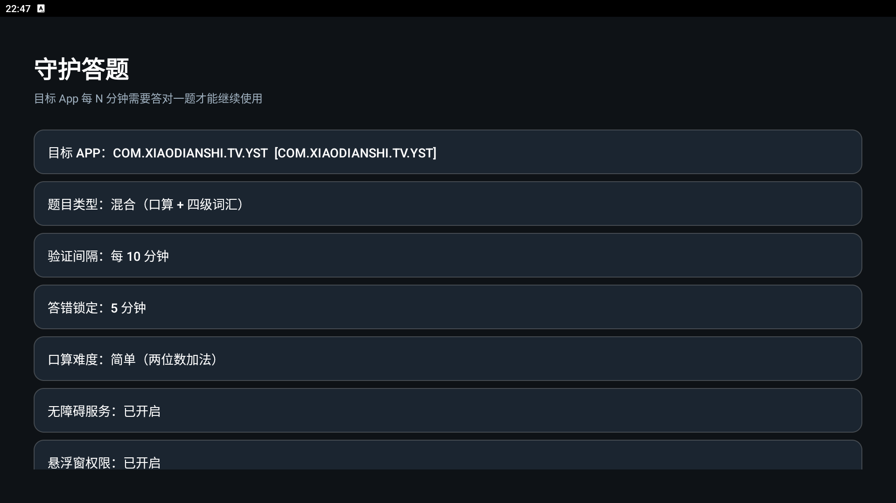
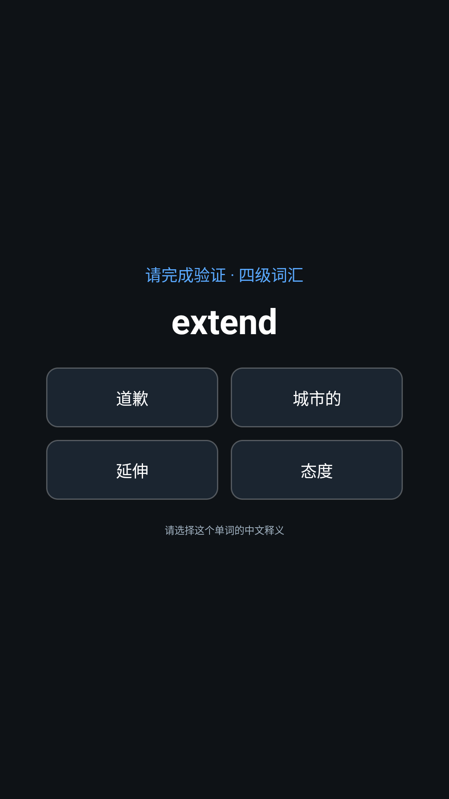
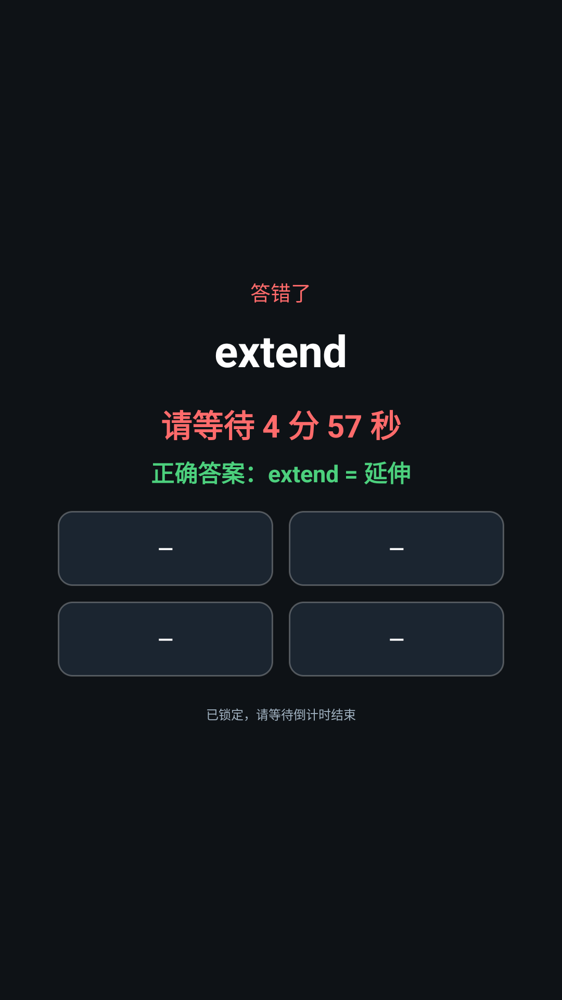

# 守护答题 · tv-guard

> 给 Android 电视/盒子用的「防沉迷」单应用守护工具：孩子要看某个 App（默认是「云视听小电视」），
> **每看 N 分钟必须答对一道题**才能继续看；答错就锁定几分钟；想关掉守护得先输入家长密码。

原生 Java，**零第三方依赖、不含 AndroidX、不联网、不读屏**（只用包名判断前后台）。

| | |
|---|---|
| 应用名 | 守护答题 |
| 包名 | `com.hermes.tvguard` |
| 版本 | 1.1 (versionCode 2) |
| SDK | compileSdk 34 / targetSdk 33 / **minSdk 23**（Android 6.0+，覆盖绝大多数电视） |
| 代码规模 | 15 个 Java 文件，约 2700 行 |
| 体积 | APK 约 66 KiB |
| 默认守护目标 | `com.xiaodianshi.tv.yst`（云视听小电视） |

## 界面

| 设置主界面 | 验证弹窗 | 答错锁定 |
|---|---|---|
|  |  |  |

全部界面适配遥控器：方向键移动焦点、Enter/确定进入，选中项有蓝色高亮描边。

## 功能

| 功能 | 说明 |
|---|---|
| **定时验证** | 被守护 App 累计在前台达 N 分钟（默认 10，可设 1/5/10/15/20/30），弹出答题界面 |
| **答对放行** | 答对后计时清零，记录一次「答对」，回到原来的 App |
| **答错锁定** | 答错进入全屏锁定倒计时（默认 5 分钟，可设 3/5/10/15/30），并展示正确答案帮助学习；期间选项全部禁用 |
| **三种题型** | 混合（口算 + 四级词汇）/ 只考口算 / 只考四级词汇；口算三档难度（两位数加法 → 乘加混合 → 带括号） |
| **家长密码** | 4 位数字 PIN，加盐 SHA-256 存储（**不存明文**）；修改配置、切换目标和启停均需验证；连错 5 次冷却 5 分钟，关闭界面或重启不能清除限制 |
| **防绕过** | 计时是**累计且持久化**的：退出再进、服务重建不会清零；答对清零。家长切换目标时重置该目标的状态 |
| **防误判** | 输入法、系统权限弹窗、systemui 等包名被忽略；「离开目标 App」需连续 3 秒确认，避免瞬时浮层误触发 |
| **离开即关** | 验证界面显示时若切走目标 App，会自动关闭验证，不打扰其他使用场景 |
| **自愈** | 前台常驻通知 + AlarmManager 看门狗定时拉起；若被 adb 授予 `WRITE_SECURE_SETTINGS`，被关掉的无障碍开关会被自动写回 |
| **开机自启** | 监听 `BOOT_COMPLETED` / `LOCKED_BOOT_COMPLETED` / `QUICKBOOT_POWERON`（兼容电视快速开机） |
| **统计与日志** | 累计弹出/答对/答错次数，附带时间戳的操作日志（保留最近 4000 字符），可一键清零 |

## 工作原理（简述）

```
无障碍事件 → 前台包名 == 被守护包名？ → 累加前台时长
   ↓ 累计 ≥ 间隔
弹 ChallengeActivity（全屏 / 忽略自己包名 / 1.2s 节流 / 已在显示则不重复拉起）
   ↓
答对 → accumulatedMs = 0，state = MONITORING，回原 App
答错 → state = LOCKED，lockedUntil = now + 锁定分钟；倒计时结束后转回答题界面
```

状态由 `GuardService`（`AccessibilityService`）持有，`ChallengeActivity` 通过静态引用读取，
`challengeVisible` 标志防止重复拉起 —— 这条是电视端体验的关键（见 `docs/TESTING.md` 的坑）。

## 安装到电视

### 方式 A：U 盘（不用电脑）

1. 把 `releases/tv-guard-v1.1-release.apk` 拷到 FAT32 U 盘
2. U 盘插电视 → 用电视文件管理器打开 APK 安装（需在设置里允许「未知来源」）
3. 打开 App → 点「无障碍服务：未开启」→ 在系统列表里打开「守护答题」
4. 点「悬浮窗权限」→ 允许
5. 点「密码：未设置」→ 设置 4 位家长密码
6. 点「目标 APP」→ 选择要限制的应用

### 方式 B：ADB 远程装（推荐，可顺便授权）

先在电视上开 ADB：`设置 → 关于本机 → 连点「版本号」7 次` → 开发者选项 → 打开「USB 调试 / ADB 调试」，
并在「安全和限制」里允许未知来源。然后：

```bash
# 连接（首次连接电视会弹授权确认，点允许）
adb connect <电视IP>:5555

# 安装
adb install -r releases/tv-guard-v1.1-release.apk

# 关键：授予写系统设置权限，守护才能自己修好被关掉的无障碍开关
adb shell pm grant com.hermes.tvguard android.permission.WRITE_SECURE_SETTINGS

# 可选：打开系统无障碍设置，在列表里启用「守护答题」
# 不直接覆盖 enabled_accessibility_services，以免禁用其他辅助服务
adb shell am start -a android.settings.ACCESSIBILITY_SETTINGS
```

> ⚠️ 测完建议关掉电视的 ADB 调试：局域网内任何人开着 ADB 都能装应用、读数据。

## 使用

首次设置 PIN 前允许初始化配置。设置 PIN 后，修改题型、间隔、锁定时长、难度、权限、切换目标、启停守护及清零统计均需家长验证；每次验证仅授权对应操作。进入设置页会暂停观看计时，重新观测到目标应用的窗口后才继续累计。

主界面从上到下：

| 项目 | 作用 |
|---|---|
| 目标 APP | 选择要守护的应用（列出所有已安装的可启动 App） |
| 题目类型 | 点一下循环切换：混合 → 只考口算 → 只考四级词汇 |
| 验证间隔 | 点一下循环：1 → 5 → 10 → 15 → 20 → 30 分钟 |
| 答错锁定 | 点一下循环：3 → 5 → 10 → 15 → 30 分钟 |
| 口算难度 | 点一下循环：简单 → 中等 → 较难 |
| 无障碍服务 | 显示是否开启；未开启时点一下跳到系统设置页 |
| 悬浮窗权限 | 同上 |
| 统计 | 弹出次数 / 答对 / 答错 + 操作日志（弹窗内可「清零」） |
| 密码 | 设置或修改家长密码 |
| 守护状态 | 运行中 / 已停止。**关闭需要输入密码**；重新启用同样需要密码 |
| 立即测试一次 | 独立预览答题/锁定界面；不修改真实计时、锁定状态或统计，返回键可退出 |

底部「自检」行每秒刷新，实时显示：服务是否连接、最近的前台包名、目标是否在前台、
已累计多少秒 / 阈值多少秒、当前状态（监控中 / 待答题 / 锁定中）。**调试时先看这一行。**

### 忘记密码怎么办

PIN 只存加盐哈希，**无法找回**。只能重装：

```bash
adb uninstall com.hermes.tvguard
```

重装后设置清空，守护随之解除。

## 权限

| 权限 | 用途 | 授予方式 |
|---|---|---|
| `BIND_ACCESSIBILITY_SERVICE`（service） | 检测前台应用（**核心**） | 设置 → 无障碍 → 守护答题 |
| `SYSTEM_ALERT_WINDOW` | 悬浮窗 | 用户授权 |
| `FOREGROUND_SERVICE` | 前台服务保活 | 自动 |
| `RECEIVE_BOOT_COMPLETED` | 开机自启 | 自动 |
| `WRITE_SECURE_SETTINGS` | 自愈时重新打开无障碍开关 | **需 adb 授予** |
| `POST_NOTIFICATIONS` | 前台服务通知 | 用户授权 |

## 编译

本项目**没有 gradle wrapper**（`gradle/wrapper/` 是空目录，既无 `gradlew` 也无 `gradle-wrapper.jar`），
所以不能直接 `./gradlew assembleDebug`。三种可行方式：

### 方式 A：Android Studio（最省事）

1. Android Studio → Open → 选项目根目录
2. Studio 会按 AGP 版本自动下载所需 Gradle
3. Run / Build APK

需要 **JDK 17**。AGP 8.9 配 Gradle 8.11 时用更高版本 JDK（21/25）常报 `Unsupported class file major version`。

### 方式 B：命令行 Gradle

```bash
# 需要 Gradle 8.11+ 与 JDK 17
gradle assembleDebug
# 产物：app/build/outputs/apk/debug/app-debug.apk
```

`settings.gradle.kts` 已配阿里云镜像（google / public / gradle-plugin），国内网络可直接解析 AGP 8.9.2。

### 方式 C：不用 Gradle（已验证可用）

`scripts/build-manual.sh` 直接调用 Android SDK 自带的 `aapt2` / `javac` / `d8` / `zipalign` / `apksigner`
手工完成整个构建，**不需要 Gradle，也不需要 Android Studio**：

```bash
# release 包（分发用，manifest 不带 android:debuggable）
./scripts/build-manual.sh --release
# 产物：releases/tv-guard-v1.1-release.apk

# debug 包（仅调试用，manifest 带 android:debuggable="true"）
./scripts/build-manual.sh
# 产物：releases/tv-guard-v1.1-debug.apk
```

> 注意：`releases/` 下的包在仓库里已提交，重新构建会覆盖同名文件（`git status` 会显示该项被修改）。
> 只是本地试构建的话，构建完可以 `git checkout -- releases/` 还原。

前置条件只有两样：**Android SDK**（`platforms/android-34` + 任意 `build-tools`）和 **JDK 17+**。
SDK 路径从 `$ANDROID_HOME` 读，读不到则读 `local.properties` 里的 `sdk.dir`。

```bash
# 换平台版本（默认 android-34）
PLATFORM=android-35 ./scripts/build-manual.sh

# 保留中间产物便于排查
./scripts/build-manual.sh --keep
```

v1.1 已用此脚本完成资源编译、Java 编译、DEX 转换及 APK 签名；签名校验和 ZIP 对齐校验通过，
包内版本为 1.1 / versionCode 2，未启用 `android:debuggable`。签名证书与仓库 v1.0 APK 相同。
本次未重新进行 AGP 对照构建。相同 SHA-256 的 APK 已完成 BlueStacks 核心流程回归及 Sony 电视覆盖部署/启动检查；验证范围及限制见 `docs/TESTING.md`。

### 构建注意事项

- **首次克隆后先建 `local.properties`**：`cp local.properties.example local.properties`，把 `sdk.dir` 改成你本机的 Android SDK 路径（或改为设置环境变量 `ANDROID_HOME`）。真实文件已被 `.gitignore` 忽略，不会提交
- `release` 构建类型当前复用 **debug 签名**（`signingConfig = debug`），仅供侧载，不可上架
- 工程若放在网络盘（NAS/SMB）上，Gradle 构建会因大量小文件 I/O 明显变慢，建议先复制到本机磁盘再编

## 参数（`SharedPreferences`，文件名 `guard`）

| key | 含义 | 默认 |
|---|---|---|
| `target` | 被守护的包名 | `com.xiaodianshi.tv.yst` |
| `intervalMin` | 验证间隔（分钟） | `10` |
| `lockMin` | 答错锁定（分钟） | `5` |
| `difficulty` | 口算难度 1/2/3 | `1` |
| `type` | 题型 0 混合 / 1 口算 / 2 四级词汇 | `0` |
| `enabled` | 守护是否启用（密码退出后为 `false`） | `true` |
| `challenges` / `correct` / `wrong` | 统计计数 | `0` |
| `log` | 操作日志 | `""` |

PIN 单独存放在 `SharedPreferences` 文件 `guard_pin`（`SHA-256(salt + PIN)` + 随机盐），错误次数与冷却状态也持久化在此文件中。

### 状态恢复策略（v1.1）

- `guard_service_state` 保存当前目标、累计观看时间、待答题/锁定状态及正确答案。关键状态变化同步落盘；观看中每 15 秒保存检查点。
- 服务恢复及空闲等待时仅核对活动窗口根节点的包名，不读取文字或子节点；即使连续播放没有新窗口事件，也能恢复守护。主界面、PIN、目标选择与测试预览直接返回前台时均暂停计时。
- 同次开机恢复锁定时使用单调时钟原始截止时间，不受手动修改日期影响。若进程在观看中中断，同次开机的中断间隔保守计入观看时间，可能包含无法观测到的非观看时间。
- 重启设备或无法确认开机标识时，保留累计观看和待答题状态，并重新等待上次保存的剩余锁定时间；不把关机时间当成已完成的锁定时间。
- 家长明确停止后保留已累计时间/待答题/锁定状态；重新启用时需要重新观测前台。家长切换目标后清除旧目标的计时与惩罚，不自动认定新目标在前台。
- PIN 连错 5 次冷却 5 分钟；关闭/重开验证页不能重置。重启时尚未完成的冷却从 5 分钟重新计，避免改系统时间或重启绕过。

## 目录结构

```
tv-guard/
├── README.md                    ← 本文件
├── app/
│   ├── build.gradle.kts
│   └── src/main/
│       ├── AndroidManifest.xml
│       ├── java/com/hermes/tvguard/     ← 15 个 Java 文件，约 2700 行
│       │   ├── GuardService.java        无障碍服务：前台判定 / 计时 / 触发验证
│       │   ├── MainActivity.java        设置主界面 + 自检行
│       │   ├── ChallengeActivity.java   真实验证界面（答题 / 锁定倒计时）
│       │   ├── TestChallengeActivity.java  独立测试预览，不改变真实状态
│       │   ├── GuardState.java          可测试的恢复与无障碍列表策略
│       │   ├── PinRetryPolicy.java      可测试的 PIN 冷却策略
│       │   ├── PinActivity.java         4 位 PIN 键盘
│       │   ├── AppPickerActivity.java   选择被守护应用
│       │   ├── Questions.java           出题（口算 / 词汇）
│       │   ├── VocabBank.java           四级词汇题库
│       │   ├── Prefs.java               配置与统计
│       │   ├── PinStore.java            PIN 加盐哈希
│       │   ├── Watchdog.java / WatchdogReceiver.java   看门狗自愈
│       │   └── BootReceiver.java        开机自启
│       └── res/                         布局 / 图标 / 颜色 / 无障碍配置
├── scripts/build-manual.sh      ← 无 Gradle 构建脚本（已验证）
├── scripts/test-regression.py   ← 无依赖纯 Java 回归检查
├── scripts/test-service-integration.py  ← 实际服务/PIN 代码 + Android 测试替身
├── tests/                      ← 确定性测试与测试专用替身
├── docs/
│   ├── TESTING.md               ← 实测记录与踩坑（含证据）
│   └── screenshots/             ← 界面截图
├── releases/
│   └── tv-guard-v1.1-release.apk     ← 当前可用包（release 构建，约 66 KiB，非调试）
├── build.gradle.kts             ← AGP 8.9.2
├── settings.gradle.kts          ← 阿里云 Maven 镜像
├── gradle.properties
├── local.properties.example     ← SDK 路径模板（复制成 local.properties 再改路径）
└── local.properties             ← 本机 SDK 路径（已 gitignore，不入库）
```

## 已知问题

1. **界面文字被强制大写**：按钮沿用了默认的 `textAllCaps`，包名可能显示成大写（仅观感问题）。
2. **没有 gradle wrapper**：不能用 `./gradlew`，见「编译」一节。
3. **强行停止仍可绕过**：BlueStacks 实测中，系统强停会移除本应用的无障碍组件，重新打开主界面也未自动连接；需重新启用服务。恢复服务后持久化锁定/答案可恢复，但这不等于强停后能自动恢复。
4. **电视完整回归仍未完成**：Sony BRAVIA（Android 7.0）已完成覆盖升级、权限保留、界面启动及服务连接检查；设备重启、低内存回收和电视端全部交互仍未验收。

v1.0 的单例竞态已在 v1.1 修复。其原始影响不仅是自检文字：空引用会让真实验证界面退出，不能视为纯展示问题。

## 验证状态

v1.1 本地验证：9,000 道确定性题目检查、29 项恢复/无障碍列表策略检查、23 项 PIN 策略检查及 46 项实际服务/PIN 存储集成检查通过。集成检查使用 Android 测试替身，不等同于设备端验收。执行：

```bash
python3 scripts/test-regression.py
python3 scripts/test-service-integration.py
```

**v1.1 设备验证（2026-11-18）**：BlueStacks / Android 13 上完成 PIN 授权、累计计时、服务重绑定、真实答对/答错、完整锁定到期、预览隔离、看门狗及 PIN 冷却实际等待；发现的强停限制未解决。相同 APK 已部署至 Sony BRAVIA / Android 7.0，启动与服务连接检查通过。详见 `docs/TESTING.md`，不宣称所有恢复场景或电视完整流程均通过。

以下为 **历史 v1.0** 验证：

v1.0 已在 **BlueStacks 5 / Android 13** 上完成端到端实测：安装、无障碍绑定、定时弹题、
答对放行、答错锁定 + 倒计时、离开自动关闭、累计计时防绕过、密码设置与密码退出、重新启用自愈，
共 15 项实测通过（另有 1 项统计清零仅核对代码路径，未单独点）。完整证据链与未实测项见 **[docs/TESTING.md](docs/TESTING.md)**。

## 版本

| 版本 | 日期 | 说明 |
|---|---|---|
| 1.1 | 2026-11-18 | 修复配置绕过、状态丢失、单例竞态、无障碍列表覆盖、测试模式污染、设置页计时、目标切换状态和 PIN 重试限制；新增回归检查 |
| 1.0 | 2026-11-04 | 首个可用版本：定时验证、答对放行 / 答错锁定、PIN 保护、看门狗自愈、开机自启 |
